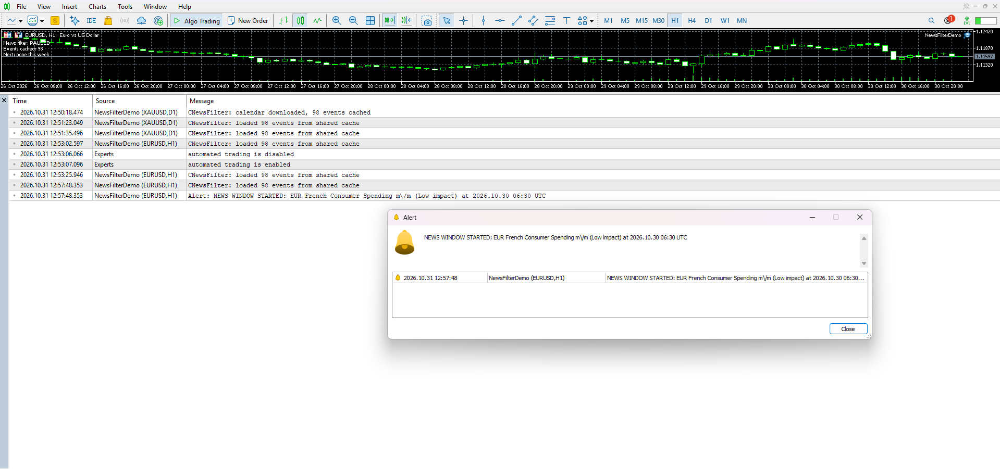
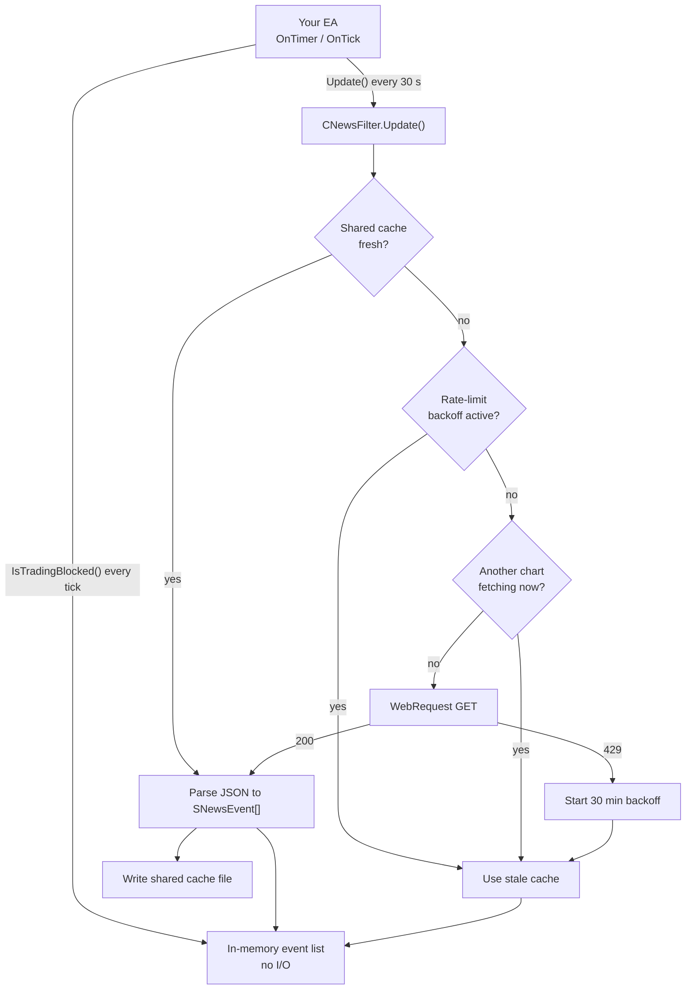

# mt5-news-candle-pauser

A small, modular **MQL5 news filter** that pauses new trade entries around high-impact economic events. It downloads an economic calendar over HTTPS with `WebRequest`, caches it safely, and exposes a clean `IsTradingBlocked()` check that any Expert Advisor can call on every tick.



*Demo account, test configuration (Low impact, extended window, to trigger a pause on demand). The chart panel shows `PAUSED`, the alert fired once when the window opened, and the Experts log shows several charts sharing one downloaded calendar.*

---

## Why this exists

Spreads widen, slippage spikes and stop-losses get skipped around major releases. Most retail EAs either ignore this or hard-code a manual blackout list. This project is a reusable component that:

- keeps itself up to date from an online calendar,
- keeps working when the network is flaky or the API rate-limits you,
- adds essentially zero cost to the tick path.

## Features

- **Configurable window**: pause *N* minutes before and *M* minutes after an event.
- **Impact and currency filters**: e.g. only High impact, only the currencies in the chart symbol (`EURUSD` watches EUR and USD automatically).
- **UTC everywhere**: event times are converted to UTC and compared with `TimeGMT()`, so broker server time and DST never matter.
- **Shared cache across charts and restarts**: one download serves every chart on the terminal.
- **Rate-limit protection**: HTTP 429 triggers a terminal-wide 30-minute backoff.
- **Fail-soft**: if a download fails, the last known calendar keeps protecting you.
- **Alert once**: a single alert when a window opens, not one per tick.

## Architecture



The key idea is a strict separation between the **slow path** (network, parsing, disk) and the **hot path** (the per-tick check). `Update()` is called from a timer and throttles itself. `IsTradingBlocked()` only walks an in-memory array.

### Components

| File | Role |
|------|------|
| `src/NewsFilter.mqh` | `CNewsFilter` class, the reusable core. Contains the data model (`SNewsEvent`, `ENUM_NEWS_IMPACT`), HTTP, parsing, caching and the blocking logic. |
| `src/NewsFilterDemo.mq5` | Minimal EA showing integration: timer refresh, state-change alerts, an on-chart status panel and the spot where strategy code goes. |

## Design decisions

- **UTC-only time handling.** The feed gives ISO-8601 timestamps with an offset (e.g. `-04:00`). They are converted to UTC once at parse time. Event times were cross-checked against MT5's built-in calendar: the 2-hour difference matched the broker's UTC+2 display.
- **Two-tier caching.** Memory for speed, a file in the terminal's shared `Common\Files` folder for sharing across charts and restarts. Each cache file stores its own save timestamp and text length, so a half-written file is detected and ignored.
- **Terminal-wide coordination with global variables.** The backoff marker and a best-effort fetch lock live in MT5 global variables, which every chart on the terminal can see.
- **No external JSON dependency.** MQL5 has no built-in JSON parser. The feed is a flat array of objects, so a small purpose-built extractor is enough and keeps the project dependency-free.
- **Defensive parsing.** Malformed entries are skipped, and the cache is only replaced if at least one event was parsed.

### A real bug this design came from

The first version kept the calendar only in memory. With three charts open, every terminal restart sent three requests within seconds, and the free API answered `HTTP 429 Too Many Requests`. The shared file cache, the backoff and the fetch lock were added in response. After the fix, the log shows one `calendar downloaded` line and `loaded 98 events from shared cache` for every other chart, with no further requests.

## Quick start

1. Copy `src/NewsFilter.mqh` and `src/NewsFilterDemo.mq5` into `MQL5\Experts\mt5-news-filter\` (they must sit in the same folder).
2. Open `NewsFilterDemo.mq5` in MetaEditor and compile with **F7**.
3. In MT5: **Tools → Options → Expert Advisors**, tick *Allow WebRequest for listed URL* and add `https://nfs.faireconomy.media`.
4. Make sure **Algo Trading** is enabled and attach `NewsFilterDemo` to a chart.

### Using it in your own EA

```mql5
#include "NewsFilter.mqh"

CNewsFilter g_news;

int OnInit()
  {
   g_news.Configure("https://nfs.faireconomy.media/ff_calendar_thisweek.json",
                    15,                 // minutes before
                    15,                 // minutes after
                    NEWS_IMPACT_HIGH);
   g_news.SetCurrenciesFromSymbol(_Symbol);
   EventSetTimer(30);
   g_news.Update(true);                 // first load
   return INIT_SUCCEEDED;
  }

void OnTimer() { g_news.Update(); }     // self-throttled, cheap to call

void OnTick()
  {
   if(g_news.IsTradingBlocked())
      return;                           // skip new entries during the news window
   // ... your strategy ...
  }
```

### Inputs of the demo EA

| Input | Default | Meaning |
|-------|---------|---------|
| `InpUrl` | faireconomy weekly feed | Calendar endpoint |
| `InpMinutesBefore` / `InpMinutesAfter` | 15 / 15 | Size of the pause window |
| `InpMinImpact` | High | Minimum impact that triggers a pause |
| `InpCurrencies` | *(empty)* | Comma list, or empty to derive from the chart symbol |
| `InpAction` | Pause trading | `Alert only` or `Pause new entries` |

## Known limitations

- **Not usable in the Strategy Tester.** MT5 blocks `WebRequest` there (error 4014). This is a live/demo component.
- **Unofficial data source.** The default feed is a free community mirror of the Forex Factory calendar with no uptime guarantee and rate limits. It only contains the **current week**. `Configure()` accepts any URL with the same JSON shape.
- **Only new entries are paused.** Open positions are not modified or closed.
- **Minimal JSON parsing.** Assumes flat objects without braces inside string values, which holds for the supported feed.
- **Fetch lock is best-effort.** Charts starting at the exact same millisecond could still both download.
- **Tested on a demo account only.**

## Roadmap

- Backtest mode: replay a saved calendar file in the Strategy Tester.
- Use MT5's built-in `Calendar*` functions as an alternative data source (no WebRequest needed).
- Optional "close or tighten stops before news" action.
- Unit tests for the parser using sample feed snapshots.

## Project structure

```
mt5-news-filter/
├── src/
│   ├── NewsFilter.mqh        # CNewsFilter class
│   └── NewsFilterDemo.mq5    # example EA
├── docs/
│   └── screenshot.png
└── README.md
```

## Disclaimer

Educational software, provided as is. It is not financial advice, and a news filter does not remove trading risk. Test on a demo account before any live use.

## License


Copyright (c) 2026 Amir Mirshahi

Permission is hereby granted, free of charge, to any person obtaining a copy
of this software and associated documentation files (the "Software"), to deal
in the Software without restriction, including without limitation the rights
to use, copy, modify, merge, publish, distribute, sublicense, and/or sell
copies of the Software, and to permit persons to whom the Software is
furnished to do so, subject to the following conditions:

The above copyright notice and this permission notice shall be included in all
copies or substantial portions of the Software.

THE SOFTWARE IS PROVIDED "AS IS", WITHOUT WARRANTY OF ANY KIND, EXPRESS OR
IMPLIED, INCLUDING BUT NOT LIMITED TO THE WARRANTIES OF MERCHANTABILITY,
FITNESS FOR A PARTICULAR PURPOSE AND NONINFRINGEMENT. IN NO EVENT SHALL THE
AUTHORS OR COPYRIGHT HOLDERS BE LIABLE FOR ANY CLAIM, DAMAGES OR OTHER
LIABILITY, WHETHER IN AN ACTION OF CONTRACT, TORT OR OTHERWISE, ARISING FROM,
OUT OF OR IN CONNECTION WITH THE SOFTWARE OR THE USE OR OTHER DEALINGS IN THE
SOFTWARE.
EOF
